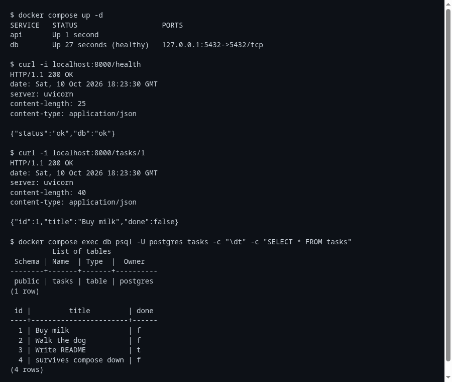

# Task API (FastAPI + PostgreSQL, containerized)

The Task API from the earlier assignments, now backed by **PostgreSQL** and packaged so the
whole stack (API + database) starts with one command.

## Run it

```bash
cp .env.example .env        # then change the password
docker compose up -d --build
curl localhost:8000/health  # {"status":"ok","db":"ok"}
```

Stop with `docker compose down` (data is kept); `docker compose down -v` also deletes the data.



## Endpoints

| Method | Path | Notes |
|--------|------|-------|
| GET | `/health` | runs `SELECT 1`; 503 if the database is down |
| GET | `/tasks` | optional `?done=true\|false` and `?search=text` |
| GET | `/tasks/{id}` | 404 `{"error": ...}` if missing |
| POST | `/tasks` | body `{"title": "..."}`, returns 201 |
| PUT | `/tasks/{id}` | partial update of `title` / `done` |
| DELETE | `/tasks/{id}` | 204 |

Errors keep the same JSON shape as before: `{"error": "..."}`; validation errors are 400.

## How it fits together

- `repository.py` is the only module that touches the database (psycopg 3, `dict_row`).
  It creates the table on startup and seeds three tasks if it is empty.
- Configuration comes from `.env` (never committed; `.env.example` shows the keys).
  Compose builds `DATABASE_URL` for the `api` container and points it at host `db`.
- `compose.yaml`: `db` (postgres:18, named volume `taskdata`, `pg_isready` healthcheck) and
  `api` (built from the `Dockerfile`), which waits for `db` to be healthy.
- **Persistence check:** a task created through the API is still there after
  `docker compose down` followed by `docker compose up -d` (it lives in the `taskdata` volume).

## Notes

- Postgres 18 expects its volume at `/var/lib/postgresql` (not `.../data`).
- Plain `docker run` for just the database:
  `docker run -d --name taskdb -e POSTGRES_PASSWORD=dev -e POSTGRES_DB=tasks -p 5432:5432 -v taskdata:/var/lib/postgresql postgres:18`
  and `psql` via `docker exec -it taskdb psql -U postgres tasks`.
- Local development without Docker for the API: `python -m venv .venv && pip install -r requirements.txt && uvicorn main:app --reload`
  (needs the database from above).
